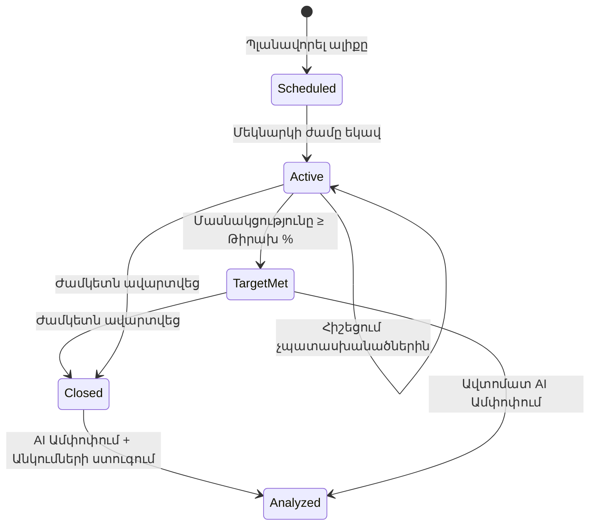
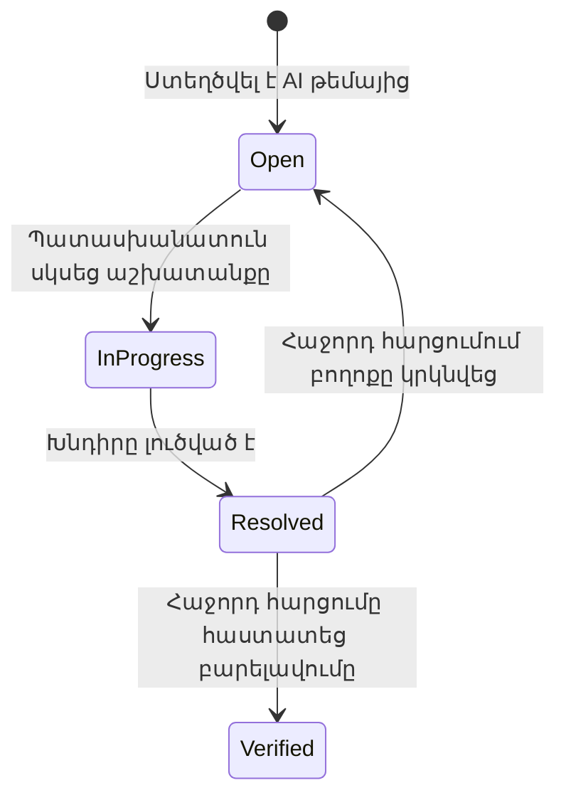

# Pulse × Picsart Academy — PRD և Domain Model (v1.0)

> [!IMPORTANT]
> **Գլխավոր սկզբունքը — «0 ուսուցում» (Zero-Friction UX).**
> Ցանկացած օգտատեր (ուսանող, դասախոս, Edu Lead, Admin Lead, Director) պետք է կարողանա կատարել իր հիմնական գործողությունը **30 վայրկյանում և առավելագույնը 2–3 սեղմումով**՝ առանց ձեռնարկ կարդալու։

---

# ՄԱՍ 1. Product Requirements Document (PRD)

## 1. Խնդիրը (Problem Statement)
Picsart Academy-ում ուսումնական որակի հարցումները պարբերաբար անցկացվում են բոլոր խմբերում (դասախոսություններ, պրակտիկա, նյութեր, կազմակերպում), բայց այսօր գործընթացը ձեռքով է.
- Ինչ-որ մեկը ձեռքով ուղարկում է հղումը և հետևում՝ ով է լրացրել, ով՝ ոչ։
- Տասնյակ մեկնաբանություններ կարդալն ու ամփոփելը ժամեր է տանում։
- Ժողովում բարձրացված խնդիրները կորչում են, և հաջորդ ամիս պարզ չէ՝ նախորդ ամսվա խնդիրը **իրականում լուծվե՞լ է**, թե՞ նույն բողոքը նորից կրկնվում է։
- Դասախոսների և խմբերի գնահատականները համեմատելիս փոքր ընտրանքները կարող են անարդար եզրակացությունների բերել։

## 2. Պրոդուկտի նպատակը և Հաջողության չափանիշները (Success Metrics)
| Չափանիշ | Ներկա վիճակ | Թիրախ (Pulse-ով) |
|---|---|---|
| Ուսանողի հարցման լրացման ժամանակ | ~3–5 րոպե | **< 45 վայրկյան** (առանց login-ի) |
| Հարցման մասնակցություն (Turnout) | ~40–50% | **≥ 75%** (ավտոմատ հիշեցումներով) |
| Մեկնաբանությունների ամփոփման ժամանակ | 2–3 ժամ ձեռքով | **< 10 վայրկյան** (AI ամփոփում) |
| Խնդիրների փակման թափանցիկություն | Անհայտ | **100%** ունի պատասխանատու, ժամկետ և ստուգում հաջորդ ալիքում |

## 3. Օգտատերերի դերերը և Գլխավոր գործողությունները (Personas & JTBD)

| Դեր | Ինչ է ուզում անել ամեն օր | Առավելագույն պարզ հոսք |
|---|---|---|
| **Ուսանող (Student)** | Արագ, անանուն գնահատել դասընթացը և թողնել կարծիք | Բացում է հղումը → 4 սեղմում (1–5) + 1 դաշտ մեկնաբանություն → Ուղարկել *(առանց login)* |
| **Edu Lead** | Տեսնել որակի անկումները, AI թեմաները և լուծել ուսումնական խնդիրները | Բացում է Pulse → տեսնում է կարմիր/դեղին ահազանգը → 1 սեղմումով թեմայից ստեղծում է խնդիր |
| **Admin Lead** | Ապահովել բարձր մասնակցություն, կառավարել խմբերը և լոգիստիկ խնդիրները | 1 սեղմումով հիշեցում / CSV-ով խմբի ներմուծում / լոգիստիկ խնդիրների փակում |
| **Director** | 2 րոպեում տեսնել ամբողջ Ակադեմիայի պատկերը և արդար համեմատությունը | Բացում է «Ժողովի ամփոփագիր» կամ «Համեմատություն» → տեսնում է տրենդը և ուշացած խնդիրները |
| **Դասախոս (Lecturer)** | Հասկանալ իր խմբի կարծիքը և բարելավել դասը | Տեսնում է **միայն իր խմբի** անանուն ամփոփումն ու տրենդը (առանց այլ դասախոսների հետ համեմատվելու) |

## 4. UX Պարզության խիստ կանոններ (Simplicity Rules)
1. **Առավելագույնը 3–4 հիմնական էջ մենյուում**՝
   - `Այսօր` (Home — միայն այն, ինչ պահանջում է գործողություն հիմա)
   - `Հարցումներ` (բոլոր ալիքները + AI ամփոփում)
   - `Խնդիրներ` (1-click կարգավիճակի փոփոխություն + ստուգում)
   - `Անալիտիկա` (Արդար համեմատություն + Ժողովի ամփոփագիր)
2. **Մեկ էկրան = մեկ հիմնական գործողություն** (ոչ մի էջում 2-ից ավելի առաջնային կոճակ չլինի)։
3. **Մարդկային լեզու** — ոչ մի տեխնիկական տերմին UI-ում (`FALLBACK`, `RBAC`, `n=3/8` փոխարինել պարզ հայերենով՝ `3 ուսանող (քիչ տվյալ)`)։
4. **Ուսանողի էջը՝ առանց շեղումների** — բացվում է հեռախոսով, 1 էկրան, 0 ավելորդ դաշտ։

## 5. Արդարության և Անանունության պարտադիր կանոններ
- **Անանունություն.** Համակարգը գիտի՝ *ով է պատասխանել* (հիշեցումը կանգնեցնելու համար), բայց **երբեք չի կապում** ուսանողի անունը նրա գնահատականի կամ մեկնաբանության հետ։
- **Արդար համեմատություն.** Եթե պատասխանների քանակը `< 5` է կամ մասնակցությունը `< 50%`, գնահատականը նշվում է «Քիչ տվյալ» նախազգուշացմամբ և չի դասվում ռեյտինգի մեջ։

---

# ՄԱՍ 2. Domain Model (DDD — Domain-Driven Design)

## 1. Սահմանափակված համատեքստեր (Bounded Contexts)

```mermaid
flowchart LR
    subgraph C1["1. Academy Directory"]
        Cohort["Cohort (Խումբ)"]
        Lecturer["Lecturer (Դասախոս)"]
        Student["Student (Ուսանող)"]
    end

    subgraph C2["2. Survey & Collection"]
        Wave["SurveyWave (Հարցման ալիք)"]
        Invite["Invitation (Հրավեր / Token)"]
        Response["AnonymousResponse (Անանուն պատասխան)"]
    end

    subgraph C3["3. Quality Intelligence"]
        Summary["AISummary (AI ամփոփում)"]
        Theme["FeedbackTheme (Թեմա)"]
        Drop["ScoreDropAlert (Անկման ահազանգ)"]
    end

    subgraph C4["4. Issue Resolution Loop"]
        Issue["QualityIssue (Խնդիր)"]
        Verify["Verification (Հաջորդ ալիքի ստուգում)"]
    end

    C1 -->|"Sync / Roster"| C2
    C2 -->|"Wave Closed / Target Met"| C3
    C3 -->|"Promote Theme to Issue"| C4
    C2 -.->|"Next Wave Scores"| Verify
```

## 2. Միասնական լեզու (Ubiquitous Language)

| Տերմին | Նշանակություն |
|---|---|
| **Cohort (Խումբ)** | Կոնկրետ դասընթացի ուսանողական խումբ՝ կցված դասախոսով (օր. `Frontend-24`)։ |
| **SurveyWave (Հարցման ալիք)** | Ժամանակացույցով պլանավորված մեկ հարցման ցիկլ խմբի համար (օր. Ալիք 1, Ալիք 2)։ |
| **Invitation (Հրավեր)** | Ուսանողի անձնական հղումը (`token`), որը հետևում է *պատասխանել է / չի պատասխանել* վիճակին և հիշեցումների քանակին։ |
| **AnonymousResponse** | 4 պարտադիր գնահատական (1–5) + ազատ մեկնաբանություն՝ **առանց `studentId` կապի**։ |
| **FeedbackTheme** | AI-ի կողմից միավորված նմանատիպ կարծիքների կլաստեր (քանակ, տրամադրություն, մեջբերումներ)։ |
| **ScoreDropAlert** | Ավտոմատ ահազանգ, երբ որևէ չափանիշ նախորդ ալիքի համեմատ իջնում է `≥ 0.4` միավորով։ |
| **QualityIssue** | Հաստատված խնդիր՝ կոնկրետ պատասխանատուով (`Edu Lead`, `Admin Lead`, `Director`) և վերջնաժամկետով։ |

## 3. Ագրեգատներ և Բիզնես ինվարիանտներ (Invariants — անխախտելի կանոններ)

1. **Anonymity Invariant (Անանունության կանոն)**
   - `AnonymousResponse`-ը **չունի և չի կարող ունենալ** `studentId` կամ `invitationId` foreign key։
   - Պատասխան ուղարկելիս մեկ տրանզակցիայով՝ (ա) ստեղծվում է `AnonymousResponse`, (բ) `Invitation.respondedAt`-ը դառնում է `now`։
2. **Single-Submission Invariant**
   - Մեկ `Invitation` token-ով կարելի է պատասխանել միայն **1 անգամ**։
3. **Smart Reminder Stop Invariant**
   - Հիշեցումն ուղարկվում է միայն եթե՝ `Wave.status == ACTIVE` **ԵՎ** `turnout < targetResponseRate` **ԵՎ** `Invitation.respondedAt == null`։ Հենց թիրախային %-ը լրանում է, հիշեցումներն ավտոմատ կանգնում են։
4. **Drop Detection Invariant**
   - `delta = currentWave.avg(dim) - previousWave.avg(dim)`։ Եթե `delta <= -0.4` → `ScoreDropAlert (MEDIUM)`, եթե `delta <= -0.7` → `ScoreDropAlert (HIGH)`։
5. **Fair Comparison Invariant**
   - `isReliable = (responseCount >= 5) && (turnoutRate >= 50%)`։ Անվստահելի ընտրանքը միշտ ցույց է տալիս նախազգուշացում։
6. **Closed-Loop Verification Invariant**
   - `QualityIssue`-ն կարող է դառնալ `VERIFIED` միայն երբ կապված է **հաջորդ** `SurveyWave`-ի հետ (`verifiedByWaveId != sourceWaveId`)։

## 4. Իրադարձությունների հոսքը (Domain Events & Lifecycle)

---

## Հաջորդ քայլի որոշում
Նախքան զրոյից կամ վերակառուցված պարզ UI-ով իրականացմանը անցնելը, նայեք այս PRD-ն և Domain Model-ը և նշեք.
1. Արդյո՞ք բոլոր դերերն ու կանոնները (ինվարիանտները) ճիշտ են արտացոլում Picsart Academy-ի իրական աշխատանքը։
2. Ուզո՞ւմ եք **ամբողջությամբ նոր մաքուր պանակում/branch-ում** սկսել 0-ից, թե՞ վերակառուցել հենց այս նախագիծը այս մաքուր Domain Model-ի և պարզ 4-էկրանանոց UX-ի վրա։
